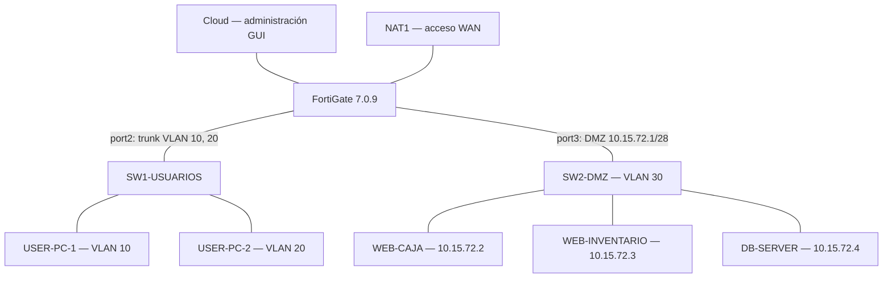

# Infraestructura 1 — DMZ, VLAN y seguridad con FortiGate

## Video demostrativo

https://youtu.be/dV10_KzzoZs

---

**Estudiante:** Oliver Eliam Aquino Paulino  
**Matrícula:** 2024-1571  
**Asignatura:** Seguridad de Redes  
**Entorno:** GNS3, FortiGate 7.0.9 (GUI), 2 switches IOSvL2, 2 usuarios Alpine Linux y 3 servidores Alpine Linux.

## Descripción

Esta práctica implementa una infraestructura segmentada con **VLAN 10 y VLAN 20 para usuarios** y una **DMZ /28 para los servidores**. El firewall FortiGate funciona como puerta de enlace, servidor DHCP para las VLAN y punto central de control de acceso.

La DMZ aloja tres servicios: **Sistema de Caja**, **Sistema de Inventario** y **base de datos MariaDB**. Las políticas diferencian el acceso según la VLAN y evitan que los servidores de la DMZ tengan salida libre a Internet o inicien conexiones no autorizadas hacia las redes LAN.

## Objetivos

- Separar usuarios en VLAN 10 y VLAN 20, con direccionamiento DHCP.
- Ubicar los tres servidores en una DMZ independiente /28.
- Permitir SSH hacia los servidores **únicamente desde VLAN 20**.
- Bloquear el acceso al Inventario desde VLAN 10 y **mostrar la página de violación de política**.
- Permitir el acceso al Sistema de Caja de forma controlada.
- Evitar conexiones iniciadas desde la DMZ hacia la LAN sin autorización.
- Limitar el acceso a Internet de la DMZ a los repositorios de actualización autorizados.
- Aplicar seguridad básica en los dos switches.
- Verificar permisos y bloqueos a través de los registros del FortiGate.

## Topología

## Componentes

| Equipo | Función |
|---|---|
| FortiGate | Firewall, VLAN, DHCP, control de acceso, Web Filter y logs |
| SW1-USUARIOS | VLAN 10/20, trunk, Port-Security, Rapid-PVST, BPDU Guard |
| SW2-DMZ | VLAN 30, Port-Security, Rapid-PVST y BPDU Guard |
| USER-PC-1 | Usuario de VLAN 10 |
| USER-PC-2 | Usuario de VLAN 20 |
| WEB-CAJA | Aplicación para registrar ventas |
| WEB-INVENTARIO | Aplicación para visualizar existencias |
| DB-SERVER | Base de datos MariaDB con productos y ventas |

## Direccionamiento

| Red / equipo | Dirección | Función |
|---|---|---|
| VLAN 10 | `10.15.71.0/25` | Usuarios con DHCP |
| FortiGate VLAN 10 | `10.15.71.1/25` | Gateway |
| USER-PC-1 | `10.15.71.2/25` | IP observada |
| VLAN 20 | `10.15.71.128/25` | Usuarios con DHCP |
| FortiGate VLAN 20 | `10.15.71.129/25` | Gateway |
| USER-PC-2 | `10.15.71.130/25` | IP observada |
| DMZ (VLAN 30 en SW2) | `10.15.72.0/28` | Red de servidores |
| FortiGate DMZ (port3) | `10.15.72.1/28` | Gateway DMZ |
| WEB-CAJA | `10.15.72.2/28` | HTTP |
| WEB-INVENTARIO | `10.15.72.3/28` | HTTP |
| DB-SERVER | `10.15.72.4/28` | MariaDB y SSH |
| FortiGate administración | `192.168.200.2/24` | GUI en port1 |
| FortiGate WAN (port4) | DHCP | Acceso a red NAT de GNS3 |

**Rangos DHCP configurados en FortiGate:** VLAN 10: `10.15.71.2–10.15.71.126`; VLAN 20: `10.15.71.130–10.15.71.254`.

## Configuración de switches

**SW1-USUARIOS:** `Gi0/0` es un trunk 802.1Q hacia FortiGate port2. Permite las VLAN 10 y 20, con VLAN 999 nativa. `Gi0/1` conecta al usuario de VLAN 10 y `Gi0/2` al de VLAN 20. Ambos puertos de usuario usan Port-Security con máximo 2 MAC, `restrict`, aprendizaje `sticky`, PortFast edge y BPDU Guard. `Gi0/3` está deshabilitado. `Gi1/0` y `Gi1/1` se utilizaron en pruebas de Windows en VLAN 10; **no tienen Port-Security**.

**SW2-DMZ:** `Gi0/0` es puerto de acceso VLAN 30 hacia FortiGate port3; `Gi0/1`, `Gi0/2` y `Gi0/3` conectan Caja, Inventario y DB. Los tres puertos de servidores tienen Port-Security, sticky, máximo 2 MAC, `restrict`, PortFast edge y BPDU Guard.

Ambos switches utilizan **Rapid-PVST**.

## FortiGate — Políticas de seguridad

Toda la configuración y demostración del FortiGate se realizó por **interfaz gráfica (GUI)**.

| Política | Aplicación |
|---|---|
| `VLAN10-INVENTARIO-BLOCKPAGE` | Pasa HTTP al Web Filter `BLOQUEO-INVENTARIO`, que bloquea el acceso y presenta una página de advertencia |
| `VLAN10-INVENTARIO-DENY` | Deniega otros accesos de VLAN 10 al Inventario |
| `VLAN10-SSH-DENY` | Bloquea SSH desde VLAN 10 a los servidores |
| `VLAN20-SSH-ALLOW` | Permite SSH desde VLAN 20 a los servidores |
| `VLAN10-CAJA-ALLOW` | Permite HTTP/HTTPS desde VLAN 10 hacia Caja |
| `VLAN20-CAJA-ALLOW` | Permite HTTP/HTTPS desde VLAN 20 hacia Caja |
| `VLAN20-INVENTARIO-ALLOW` | Permite HTTP/HTTPS desde VLAN 20 hacia Inventario |
| `DMZ-UPDATES-ALLOW` | Permite HTTPS desde DMZ hacia el objeto FQDN `UPDATE-ALPINE` |
| `DMZ-INTERNET-DENY` | Niega las demás conexiones desde DMZ hacia WAN |
| `Implicit Deny` | Bloquea conexiones no autorizadas, incluidas iniciadas desde DMZ hacia LAN |

**Actualizaciones:** el objeto `UPDATE-ALPINE` usa el FQDN `dl-cdn.alpinelinux.org`. La política correspondiente tiene NAT habilitado. Una política de denegación posterior impide el acceso general a otros destinos por la WAN.

**Página de bloqueo:** se modificó el Replacement Message `url-block` para mostrar *ACCESO DENEGADO — Violación de política de seguridad* al intentar abrir Inventario desde VLAN 10. Esto fue demostrado desde un navegador de Windows conectado temporalmente a la VLAN 10.

## Sistemas WEB y MariaDB

- **Sistema de Caja:** `http://10.15.72.2/`. Se registró una venta de un Mouse por RD$650.
- **Sistema de Inventario:** `http://10.15.72.3/`. La VLAN 10 ve la página de bloqueo; VLAN 20 tiene acceso autorizado.
- **MariaDB:** servidor `10.15.72.4`, base `redes1571`, tablas `productos` y `ventas`. La venta se comprobó también con una consulta SQL.

## Pruebas realizadas

1. Verificación de VLAN, trunk y seguridad de los dos switches.
2. Verificación de las IP de usuario en las redes /25.
3. Acceso autorizado al Sistema de Caja y registro de una venta.
4. Bloqueo visual de Inventario desde VLAN 10, registrado en Web Filter.
5. Conexión SSH exitosa desde VLAN 20 a DB-SERVER.
6. Denegación SSH desde VLAN 10, comprobada en Forward Traffic.
7. Reglas de actualización de la DMZ y denegación de Internet no autorizado.
8. Restricciones de comunicación de la DMZ hacia las VLAN de usuarios mediante Implicit Deny.

Las pruebas de Internet se validan con **los registros del FortiGate**: un timeout o fallo de DNS aislado no permite atribuir la causa a una política específica.

## Archivos del repositorio

### Running-configs y configuración relevante

- [SW1-USUARIOS — extracto sanitizado](running-configs/SW1-USUARIOS_configuracion_relevante.txt)
- [SW2-DMZ — extracto sanitizado](running-configs/SW2-DMZ_configuracion_relevante.txt)
- [FortiGate — extracto sanitizado del respaldo](running-configs/FortiGate_configuracion_relevante_SANITIZADA.conf)

### Scripts, direccionamiento y pruebas

- [Comandos de pruebas](scripts/Comandos_Pruebas_Infraestructura1.txt)
- [Direccionamiento y puertos](scripts/Direccionamiento_y_Puertos_Infraestructura1.txt)
- [Descripción de servicios y resultados](scripts/Explicacion_y_Pruebas_Infraestructura1.md)

### Documentación

El informe PDF de la Infraestructura 1, con capturas de pantalla y anexos técnicos, se preparó como documento de entrega independiente. Los extractos públicos de este repositorio omiten contraseñas, hashes y otros datos de autenticación; **no son respaldos completos restaurables**.

## Conclusión

La Infraestructura 1 muestra una red segmentada con dos VLAN de usuarios y una DMZ /28 protegida por FortiGate. Se validaron el acceso controlado a los sistemas web, los registros de ventas en MariaDB, la administración SSH exclusiva desde VLAN 20, el bloqueo visual del Inventario para VLAN 10 y las restricciones de tráfico de la DMZ.

**Video demostrativo:** https://youtu.be/dV10_KzzoZs
